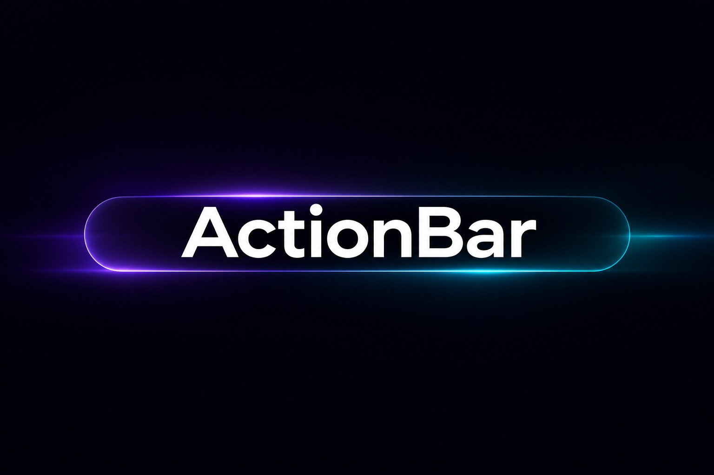
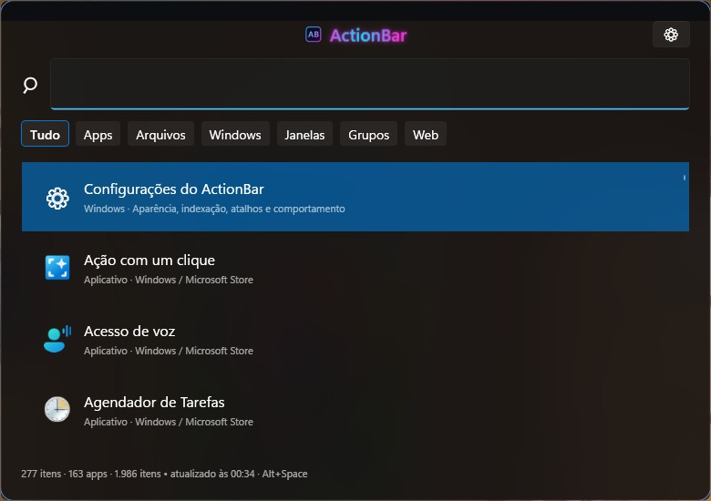
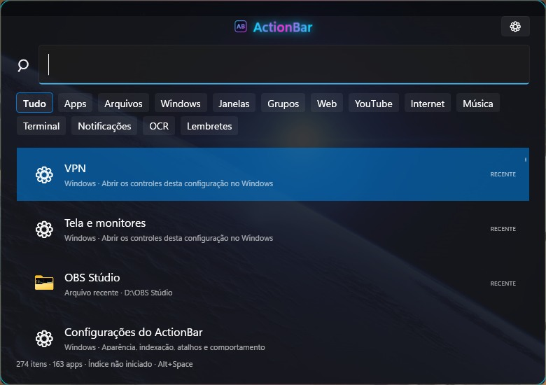
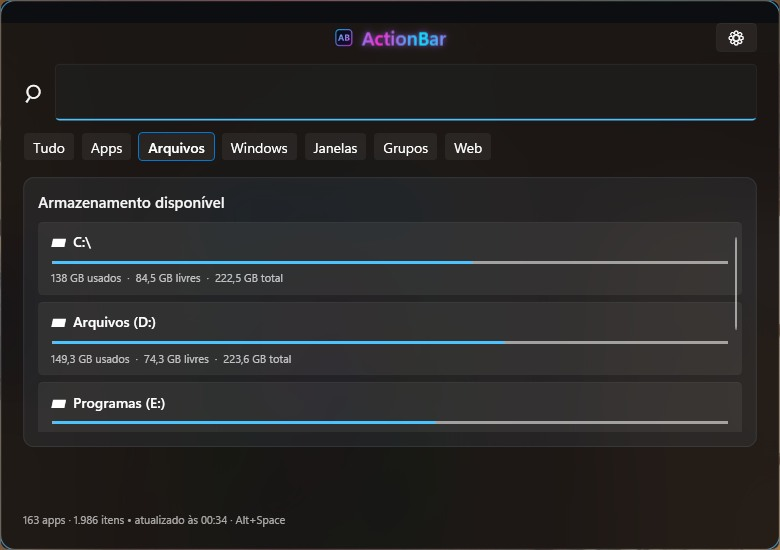
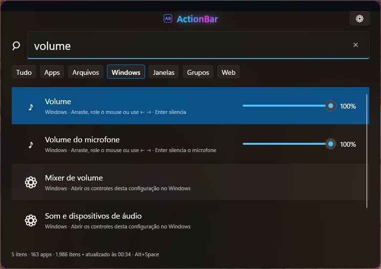
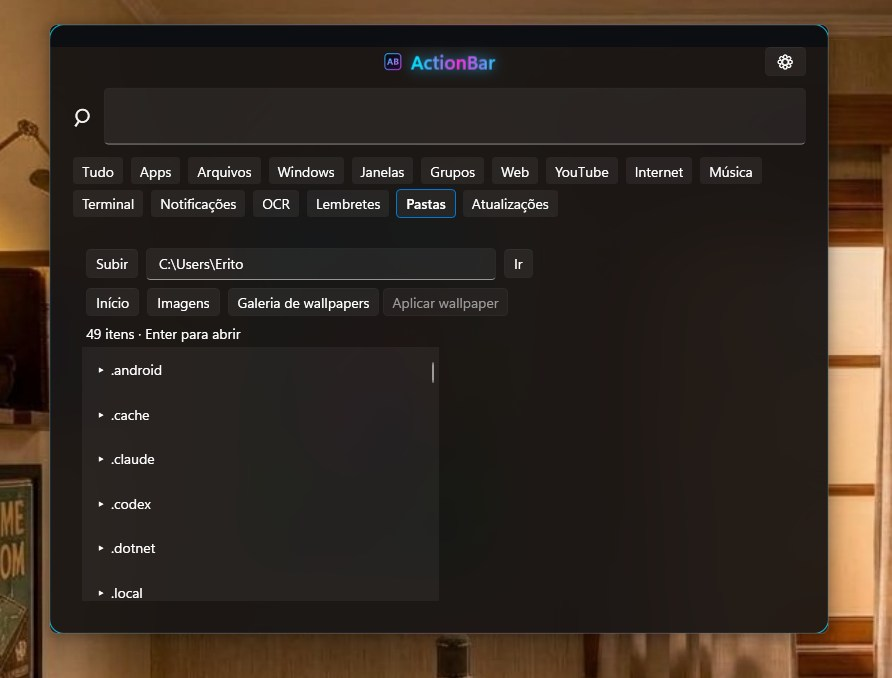
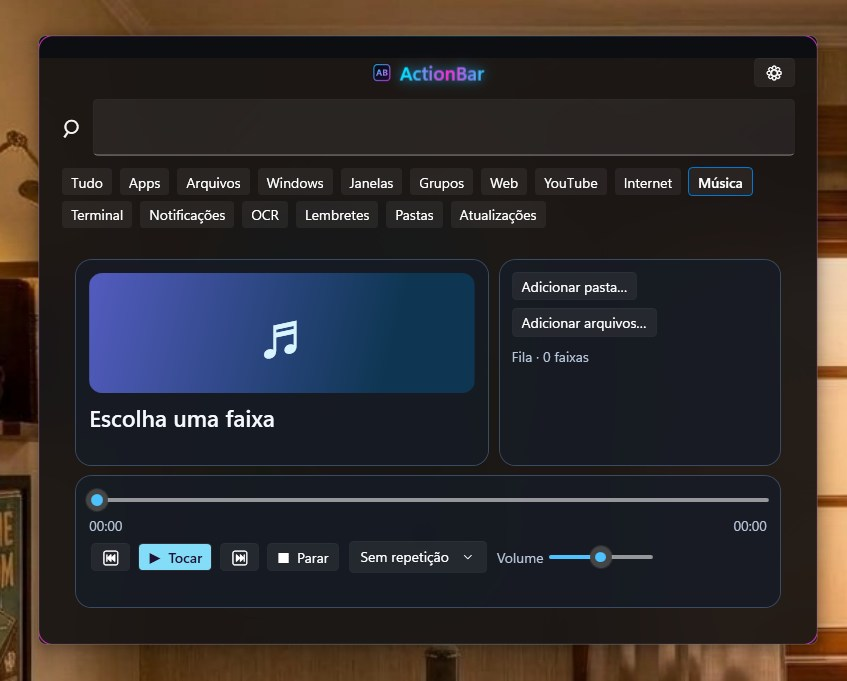
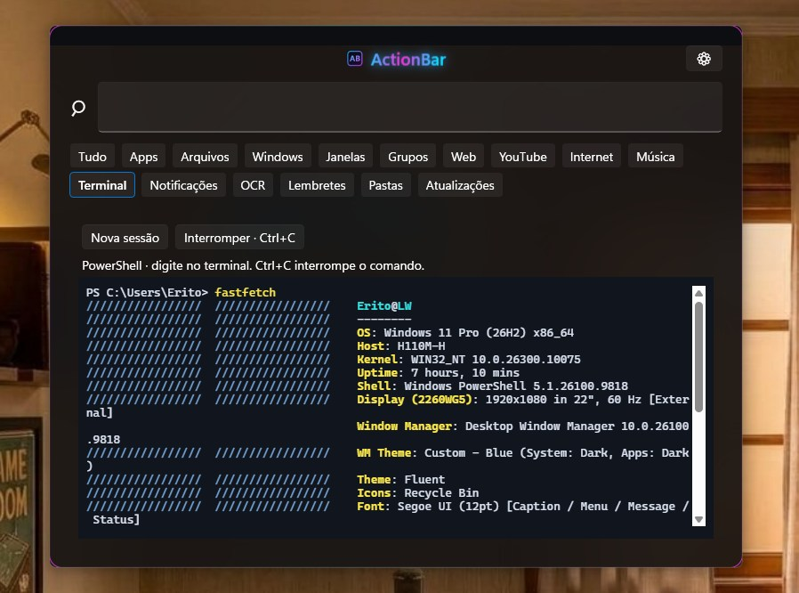
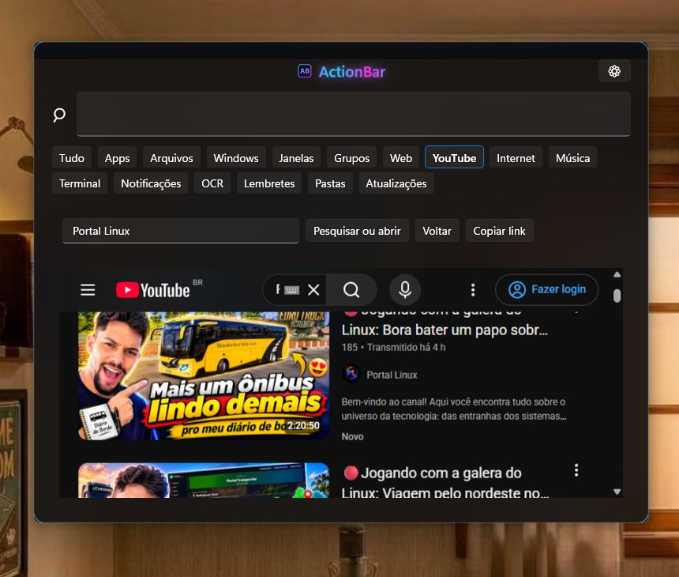

# ActionBar

Barra de pesquisa e ações rápidas para Windows e Linux. Encontre aplicativos e arquivos, execute comandos em um terminal interativo, reproduza músicas e vídeos, reconheça texto da tela e agende lembretes.

## Instalação

| Sistema | Pacote |
| --- | --- |
| Windows 10/11 x64 | **ActionBar-0.6.4-Windows-x64-Setup.exe**. Instalador por usuário, com opção de importar dados da edição portátil. |
| Ubuntu e derivados x86-64 | **actionbar_0.6.4_amd64.deb**. Instale com sudo apt install ./actionbar_0.6.4_amd64.deb. |
| Outras distribuições x86-64 | **ActionBar-0.6.4-Linux-x64.run**. Execute com sh ActionBar-0.6.4-Linux-x64.run. |

Consulte [Releases](https://github.com/eritongrnascimento-svg/ActionBar/releases) para a disponibilidade dos arquivos e leia o [guia Linux](linux/README.md) para os requisitos e as diferenças entre desktops. Os scripts para compilar os instaladores estão em [packaging](packaging).

## Capturas da versão Windows

| Barra de pesquisa | Itens recentes |
| --- | --- |
|  |  |
| **Armazenamento** | **Controles de volume** |
|  |  |
| **Pastas** | **Player de música** |
|  |  |
| **Terminal interativo** | **Pesquisa no YouTube** |
|  |  |

## ActionBar 0.6.4

- **OCR.** O botão Traduzir abre o Google Tradutor dentro da barra quando nenhuma chave do Azure está configurada. A tradução automática após a captura continua disponível pelo Azure. O texto enviado ao tradutor web é processado pelo serviço online.
- **Pastas.** Em Configurações → Pesquisa e arquivos, escolha a pasta inicial e quais atalhos de unidades são exibidos.
- **Centralização.** Em Configurações → Comportamento, centralize todas as novas janelas elegíveis, desligue a função ou adicione aplicativos à lista de exceções. O porte Linux faz a centralização em X11 quando wmctrl está disponível.

## ActionBar 0.6.3 para Windows

As abas de YouTube, Internet, Música, Terminal e as outras ferramentas abrem dentro da janela principal. YouTube usa a página de resultados do próprio YouTube no Microsoft Edge WebView2. Cole um link ou pesquise por termo, e abra um vídeo para poder copiar o link. A aba Internet também usa WebView2. O terminal incorpora uma sessão PowerShell com ConPTY e xterm.js.

## Guia da versão Windows 0.6.2

## O que mudou na versão 0.6.2

- **Terminal.** Digite direto no console PowerShell, inclusive quando um comando pedir resposta. A sessão mantém diretório e variáveis, aceita Ctrl+C e pode ser reiniciada com Nova sessão. O console usa ConPTY e xterm.js local, com licenças em Assets/Terminal.
- **OCR.** A ação de OCR pergunta se você quer ler a tela inteira do monitor ou selecionar uma área. A tradução online continua disponível.
- **Música.** Adicione arquivos ou uma pasta com subpastas, escolha faixas na fila e use os controles de reprodução, busca na faixa, volume e repetição da fila ou da faixa. O player lê capa e dados de álbum quando disponíveis no arquivo ou usa a capa da pasta.
- **YouTube.** O player usa um documento com origem HTTPS e envia o Referer com a identidade da aplicação. O YouTube ainda pode restringir vídeos específicos ou a reprodução na edição portátil.


## O que mudou na versão 0.6.1

- **Terminal.** Enter executa o comando e a saída aparece durante a execução. Use Cancelar para interromper. O painel usa PowerShell sem prompts interativos. O comando winget update consulta upgrades de aplicativos.
- **YouTube.** Cole links de vídeos, lives, Shorts ou youtu.be na aba YouTube ou na busca principal. Clique em Abrir ou pesquisar para carregar o vídeo.
- **Histórico.** A barra abre com a busca limpa. Em Configurações → Comportamento, habilite Guardar histórico de itens usados para voltar a registrar e sugerir itens recentes.
- **OCR.** Use Selecionar área para arrastar sobre o monitor ou Ler monitor para capturá-lo inteiro. A tradução pelo Azure Translator envia somente o texto reconhecido quando solicitada. Configure ACTIONBAR_TRANSLATOR_KEY no ambiente da barra e ACTIONBAR_TRANSLATOR_REGION se o recurso for regional. Ative Traduzir após o OCR (online) para automatizar essa etapa.
- **Atualizações.** Verificar atualizações abre a consulta do Windows Update dentro da barra. A animação indica que a verificação está em andamento. O progresso fica indeterminado durante a consulta porque a API informa a conclusão, sem percentual intermediário.
- **Pastas e wallpapers.** Use a aba Pastas para navegar na pasta pessoal, em Imagens ou em um caminho digitado. Trocar wallpaper sugere imagens da pasta Imagens e das pastas de papel de parede do Windows. Selecione uma imagem para ver a prévia e use Aplicar wallpaper.
- **Música.** O player ganhou uma nova interface com barra de posição, duração, volume e controles de reprodução.


Central de pesquisa e ações rápidas para Windows. Interface WPF Fluent, tema escuro profundo com Acrylic nativo, pesquisa de arquivos, aplicativos, configurações e workspaces.

## Abrir

Execute `Iniciar.cmd` ou `app\ActionBar.exe`. (Até a 0.4 o programa se chamava Barra Inteligente; a pasta do projeto e o namespace interno mantêm esse nome.) Use **Alt + Espaço** para mostrar ou esconder a barra. O atalho pode ser alterado em Configurações → Atalhos e ações. O ícone na bandeja oferece Abrir, Configurações, Atualizar índice e Sair.

Requer **.NET Desktop Runtime 10**, já disponível no computador usado para esta atualização. Mantenha a pasta `app` inteira. Os dados continuam em `app\data`; a atualização não apaga configurações nem workspaces existentes.

## Pesquisar

Digite normalmente ou use os botões de filtro:

| Entrada | Resultado |
| --- | --- |
| `chrome` / `app: chrome` | Programas encontrados no atalhos, registro de instalação, pastas de aplicativos instalados e apps do Windows / Store |
| `arquivo: orçamento` | Arquivos e pastas dentro das fontes indexadas |
| `pesquisar arquivo orçamento` | Pesquisa de arquivos em português |
| `obs d` / `d: obs` / `obs no d` | Itens da unidade D primeiro, depois os demais |
| `pasta obs` / `arquivo obs` | Só pastas ou só arquivos |
| `config: bluetooth` | Acesso à página de Bluetooth do Windows |
| `volume` / `microfone` | Barra de volume ou de nível do microfone na própria linha |
| `volume 35%` | Ajustar o volume principal para 35% |
| `ativar tema escuro` | Aplicar o tema escuro do Windows |
| `transparência` / `animações` | Ações para ativar ou desativar esses efeitos do Windows |
| `energia` | Planos de energia e página de energia/bateria |
| `gerenciador de tarefas` | Abrir a ferramenta nativa |
| `iniciar serviço Spooler` | Solicitar inicialização do serviço, com confirmação e elevação |
| `parar serviço Spooler` | Solicitar parada do serviço, com confirmação e elevação |
| `12 * (8 + 2)` | Calculadora; Enter copia o resultado |
| `sqrt(144)` / `2^8` | Funções e potências |
| `15% de 200` / `200 * 15%` | Porcentagens |
| `10 km em m` / `2 horas em minutos` / `32 f em c` | Conversão de unidades |
| `grupo: Trabalho` | Abrir um grupo e aplicar seu layout |
| `web: previsão do tempo` | Pesquisa no mecanismo e navegador escolhidos |
| `saída de áudio` / `usar alto-falantes` | Lista as saídas ativas e torna a escolhida padrão |
| `microfone` / `silenciar microfone` | Trocar o microfone padrão ou alternar o mudo |
| `janela: chrome` / `alternar para discord` | Ir para uma janela aberta |
| `encaixar à esquerda` / `sempre no topo` / `maximizar` | Agir na janela que estava em foco antes de abrir a barra |
| `mostrar área de trabalho` / `nova área de trabalho virtual` | Atalhos de Win+D, Win+Tab e desktops virtuais |
| `fechar chrome` / `processos` | Encerrar um programa (com confirmação) ou ver os que mais usam memória |
| `reiniciar explorer` | Reiniciar o Explorador quando a barra de tarefas trava |
| `ip` / `limpar dns` / `ping google.com` | Copiar IP local ou público, limpar cache DNS, renovar IP, testar conexão |
| `desligar em 30 min` / `reiniciar às 23:30` | Agendar desligamento ou reinício; `cancelar desligamento` desfaz |
| `encerrar sessão` | Sair da conta, com confirmação |

Erros de digitação são tolerados quando a busca exata não encontra nada (`volme`, `impresoras`). Ações que não existem neste PC ficam ocultas: sem adaptador Wi-Fi, rádio Bluetooth ou segundo monitor, as páginas e ações correspondentes não aparecem na pesquisa (continuam disponíveis para atalhos personalizados).

↑ e ↓ navegam; Enter executa; Esc fecha. → no fim do texto vai para a próxima aba e ← no início volta, mantendo a pesquisa; Tab e Shift+Tab também trocam de aba. Em uma linha com barra (volume, microfone), ← e → ajustam o valor em 5%, a roda do mouse sobre a linha ajusta em 2%, e dá para arrastar. O menu de contexto dos resultados permite copiar caminhos e localizar arquivos no Explorador. O botão ⚙ abre as configurações.

O catálogo inclui configurações de rede, áudio, tela, personalização, armazenamento, acessibilidade, dispositivos, aplicativos, contas, atualização e outras áreas. Resultados descritos como "Abrir os controles" abrem a página nativa; eles não fingem alterar silenciosamente a configuração. Ações diretas incluem tema, volume, mídia, bloqueio, suspensão, desligamento, reinicialização, transparência, animações e planos de energia. Planos disponíveis dependem do hardware e das políticas do Windows.

## Configurações

O painel tem nove áreas:

1. **Pesquisa e arquivos** — escolha unidades e pastas, habilite a pesquisa, ajuste o limite do índice, reconstrua ou interrompa a indexação. Inicialmente são usadas Documentos, Área de Trabalho e Downloads. Para pesquisar seus outros arquivos em D: ou em outras unidades, marque as unidades e use **Salvar e reconstruir índice**. A indexação roda em segundo plano, mostra o progresso e é atualizada ao iniciar e a cada 15 minutos quando a opção automática está ativa.
2. **Pesquisa na web** — escolha Google, Bing ou DuckDuckGo e use o navegador padrão do Windows, um navegador detectado ou um executável selecionado. Essa escolha só vale para a barra.
3. **Aparência** — tema Escuro (padrão), Claro ou Sistema; vidro; fonte; tamanho do texto e da janela; animações e duração; ícone da pesquisa; imagem de fundo e opacidade.
4. **Notificações** — habilitação, animação, posição, duração e prévia dos balões da barra. Notificações de outros aplicativos continuam sob controle do Windows.
5. **Calculadora** — habilitação e campo de teste. Suporta operações, parênteses, potências, porcentagens, sqrt, abs, sin, cos, log e ln. Aceita vírgula decimal. Trigonometria usa radianos. Converte distância, massa, tempo, temperatura e armazenamento; não usa taxas de câmbio online.
6. **Atalhos e ações** — atalho principal, verificação de disponibilidade e atalhos personalizados para aplicativos, páginas e serviços. O Windows não fornece enumeração geral dos atalhos de todos os processos; mostramos combinações nativas conhecidas e testamos o registro das suas combinações. Atalhos Win permanecem reservados ao sistema. Para serviços, os destinos avançados usam `service:start:Nome` ou `service:stop:Nome`.
7. **Agrupamento de janelas** — seis modelos: duas colunas, principal com duas laterais, três colunas, grade 2×2, duas linhas e seis painéis. Escolha o monitor e associe um aplicativo e argumentos opcionais a cada posição. Também pode capturar janelas já organizadas. Os grupos são encontrados pelo nome na barra.
8. **Comportamento** — iniciar com o Windows, iniciar na bandeja ou com a barra aberta, prioridade do processo, manter acima de outras janelas, fechar ao perder foco, limpar a pesquisa e centralização de novas janelas. O modo de inicialização é respeitado quando iniciado pelo Windows; abrir manualmente o aplicativo mostra a barra.
9. **Sobre** — versão, descrição e pasta dos dados.

As alterações de preferências só entram em vigor ao clicar em **Salvar e aplicar**. A configuração de inicialização usa a chave Run do usuário atual, sem instalação de serviço.

## Ranking de arquivos

Cada resultado recebe uma pontuação:
- **Nome:** nome igual ao texto vale mais que nome que começa com ele, que vale mais que palavra do nome que começa com ele (`obs` encontra "OBS Stúdio" e "gravacao-obs", mas não pontua "jobs" como início de palavra). Correspondência só no caminho vale menos, a não ser que uma pasta acima tenha o nome buscado.
- **Itens do usuário:** pastas que guardam vídeos, fotos ou documentos sobem. O conteúdo interno de projetos de código (pastas com `CMakeLists.txt`, `package.json`, `.csproj`…), de pastas de instalação (Program Files, plugins, cache, build…) e de pastas ocultas desce. Arquivos técnicos (`.dll`, `.json`, `.h`…) perdem pontos.
- **Profundidade:** itens rasos valem mais. Dentro da pasta do usuário, a profundidade conta a partir dela.
- **Uso e data:** o que já foi aberto pela barra ganha um bônus que cai conforme fica antigo, e itens modificados recentemente desempatam.
- **Unidade:** uma letra de unidade existente no começo ou no fim (`obs d`, `d: obs`, `d:obs`, `obs no d`) coloca primeiro os itens daquela unidade. Os demais aparecem depois.

Com texto digitado, os arquivos RECENTES mantêm o rótulo, mas seguem a pontuação, em vez de sempre irem para o topo. Os resultados de arquivos mostram uma miniatura real (imagens, vídeos, PDFs) quando o Windows tem uma; senão, o ícone do tipo.

Durante a reindexação automática, a pesquisa continua usando o índice anterior completo até o novo terminar.

## Indexação e privacidade

A busca usa nomes e caminhos de arquivos e pastas; não lê o conteúdo dos documentos. O índice local fica em `app\data\files.json`. Ele só retorna itens das fontes atualmente selecionadas. Diretórios inacessíveis, links simbólicos, pontos de nova análise e algumas pastas volumosas ou de sistema (Windows, AppData, node_modules, .git, entre outras) são ignorados.

A barra abre compacta, vazia e com o foco no campo de digitação. Digitar expande os resultados. Clicar em um filtro também expande a barra e exibe sua lista imediatamente, sem inserir prefixos no texto. As três últimas entradas usadas em cada categoria recebem o rótulo RECENTE e ficam no topo. O histórico é local, limitado a 200 itens e salvo em settings.json. Os resultados de Apps e navegadores usam ícones reais do Shell ou do executável, carregados em segundo plano.

A aba Apps não varre o PATH nem lista ferramentas internas de console/Win32, desinstaladores ou auxiliares conhecidos. Ela usa atalhos, registro de instalação, executáveis gráficos de pastas instaladas e o menu de aplicativos do Windows / Store. Ações, ferramentas administrativas e páginas de configuração ficam em Windows e também podem ser encontradas em Tudo. Alguns aplicativos portáteis sem atalhos nem registro podem aparecer apenas na pesquisa de arquivos.

Ao abrir Arquivos, os cartões mostram as unidades disponíveis, capacidade total, espaço usado e livre. Unidades sem mídia são identificadas como indisponíveis. Ao abrir Web, são listados os navegadores detectados e o widget de clima; escolher um navegador nessa lista não altera o padrão do Windows.

Digitar CPU, GPU, memória, RAM, hardware, recursos, processador ou termos relacionados em Tudo/Windows exibe um monitor ao vivo. Ele mede CPU, memória física e utilização do mecanismo de GPU mais ocupado. As leituras são atualizadas a cada segundo, somente enquanto o widget está visível. A GPU pode aparecer como indisponível se o driver não fornecer os contadores. Não são estimadas temperaturas, frequências ou outros sensores não disponibilizados pelo sistema.

O clima tenta obter um relatório recente de localização já disponível no Windows, sem solicitar permissões nem alterar preferências de privacidade. Na ausência dele, usa IPWho.is para estimar a região da conexão. As coordenadas são arredondadas a duas casas decimais e consultadas no Open-Meteo; o widget identifica a origem. Essa integração externa foi autorizada pelo usuário nesta sessão. Não é usada detecção baseada no fuso horário. A localização não é salva no histórico ou no arquivo de configurações; a resposta fica em cache na memória por 15 minutos. É possível desativar o clima em Pesquisa na web. Em caso de erro de rede, o widget mostra indisponibilidade, sem inventar condições.

A pesquisa é assíncrona, com cancelamento ao digitar novamente. O índice é limitado ao número de itens configurado. Arquivos novos ou renomeados entram na próxima reconstrução automática ou manual. A busca web só é enviada ao navegador quando o usuário executa o resultado correspondente. As consultas automáticas de clima são independentes da busca web e acontecem ao abrir a aba Web com o widget habilitado.

A ação **Copiar IP público** consulta `api.ipify.org` somente quando é executada. Ping, DNS e IP local não usam serviços externos.

Trocar o dispositivo de áudio padrão usa a interface `IPolicyConfig` do Windows, a mesma do painel de Som; ela não é documentada oficialmente. Encerrar um programa primeiro pede às janelas que fechem e só finaliza o que não responder em 3 segundos; processos essenciais do sistema nunca são oferecidos.

A interpretação dos comandos é local, por regras e catálogo. Não há modelo de IA generativa integrado, envio de arquivos para IA ou execução arbitrária de comandos de terminal a partir da pesquisa.

## Janelas e workspaces

Novas janelas principais normais são centralizadas na área útil do monitor, sem exibir marcações. Janelas já existentes ao iniciar a barra são preservadas. Diálogos com proprietário, ferramentas, janelas internas do sistema, minimizadas e maximizadas não são centralizados.

Antes de iniciar um grupo, todos os seus executáveis são reservados; suas janelas ficam isentas da centralização durante a abertura. Os aplicativos são iniciados em paralelo, janelas existentes podem ser reutilizadas e cada posição recebe uma janela distinta. O programa espera até 20 segundos por aplicativo e mantém a reserva por mais dois segundos ao concluir. Aberturas manuais do mesmo executável durante essa reserva também são isentadas.

Os layouts usam pixels físicos. Quando um monitor está desconectado, o layout é limitado à área útil do monitor principal. Aplicativos podem impor dimensões mínimas ou se reposicionar depois. Apps elevados, jogos, aplicativos de loja e programas que usam executáveis intermediários podem exigir adaptações. Atalhos comuns são resolvidos para seus executáveis quando possível. Capturar um workspace não recupera automaticamente documentos, abas ou argumentos originais.

A marcação ao redor do monitor aparece somente após ativar um agrupamento com pelo menos uma janela posicionada. Ela fica restrita aos monitores das janelas do grupo, desaparece quando todas estão minimizadas e retorna ao restaurá-las. Fechar todas as janelas ou executar **Encerrar agrupamento** (na barra ou na bandeja) remove a marcação. Encerrar o agrupamento mantém os aplicativos abertos. Fora de um agrupamento ativo, nenhuma janela comum cria a marcação.

## Ações de janela e atalhos

As ações de janela (maximizar, encaixar, centralizar, sempre no topo, fechar, mover de monitor) agem sobre a janela que estava em foco quando a barra foi aberta; a descrição do resultado mostra o título dela. Quando não havia janela em foco, essas ações não aparecem. Elas também podem virar atalhos personalizados (por exemplo `action:win-left`); nesse caso agem sobre a janela em foco no momento do atalho. Janelas de aplicativos executados como administrador podem recusar as alterações.

## Arquitetura das ações

Todas as ações executáveis ficam em `Actions.cs` (`ActionRegistry`): uma lista de ações fixas e um interpretador de texto (`Interpret`) para pedidos com parâmetros. Cada ação tem um destino `action:nome` ou `action:nome:argumento`, que é o que atalhos e histórico guardam; destinos da 0.3 foram preservados. Ações de risco pedem confirmação no próprio handler. Implementações por área: `Audio.cs`, `WindowActions.cs`, `SystemTools.cs` (processos, rede, agendamento e detecção de recursos) e `Fuzzy.cs` (busca tolerante).

## Aparência e compatibilidade

O tema padrão é escuro profundo: uma camada quase preta sobre Acrylic do DWM. O vidro nativo depende de Windows 11 build 22621 ou superior e das preferências de transparência do sistema. Em outros cenários, a aparência usa fundo sólido. Os controles são do tema Fluent do WPF. Animações respeitam a preferência de movimento do Windows.

## Pacotes para outras pessoas

```powershell
.\publicar-release.ps1 -Notas "O que mudou 1","O que mudou 2"
```

Gera um executável único (já inclui o .NET) em `releases\ActionBar-<versão>-win-x64.zip`, com `LEIA-ME.txt` e o histórico. A versão vem de `<Version>` no `BarraInteligente.csproj`: aumente-a antes de um pacote novo. Os pacotes antigos nunca são apagados nem substituídos, e `releases\HISTORICO-DE-ATUALIZACOES.txt` ganha uma entrada no topo a cada pacote. A montagem usa sempre `obj\release-staging`, apagada no fim. Os .zip ficam fora do git; o histórico fica no git.

## Identidade visual

Nome **ActionBar**, logo **AB** em neon. `Assets\gerar-icone.ps1` gera `Assets\ActionBar.ico` (16 a 256 px, desenhado por tamanho), embutido no executável e usado na bandeja e nas janelas. O título no topo da barra fica centralizado, com cores fluindo e brilho pulsante, e a borda usa o mesmo gradiente. As animações seguem a opção de animações da barra e a preferência de movimento do Windows.

## Desenvolvimento e testes

Alvo: `net10.0-windows`. Sem pacotes NuGet externos. A API ThemeMode do WPF ainda exige adesão explícita ao diagnóstico WPF0001; a opção está documentada e isolada nos arquivos de interface.

```powershell
dotnet build .\BarraInteligente.csproj -c Release
dotnet run --project .\Tests\Tests.csproj -c Release
dotnet publish .\BarraInteligente.csproj -c Release --no-self-contained -o .\app
dotnet .\app\BarraInteligente.dll --smoke-test --interaction-test --settings-render-test
```

Os testes verificam calculadora e conversões, atalhos, catálogo, os seis layouts, migração e persistência das configurações, indexação e cache, filtros de diretórios, centralização, ausência de marcação em janelas comuns, ativação/remoção da marcação dos grupos e a exceção dos workspaces. A verificação de inicialização testa a janela nativa, o registro/alternância do atalho e a renderização das nove páginas. O painel, a abertura compacta, a digitação sem clique, os ícones, os filtros, os discos, o monitor e o clima automático também foram inspecionados visualmente. Os testes também cobrem o registro de ações, a busca tolerante, a interpretação de desligamento agendado, ping, volume e processos, o encaixe e a fixação de uma janela de teste e a reaplicação da saída de áudio atual (sem mudar o dispositivo). Os testes não desligam o computador, alteram tema, executam serviços, encerram programas ou modificam volume real. Feche a barra em execução antes de rodar os testes: ela centraliza as janelas de teste e faz os testes de workspace falharem.

Referências oficiais: [Fluent no WPF](https://learn.microsoft.com/en-us/dotnet/desktop/wpf/whats-new/net90), [páginas das Configurações](https://learn.microsoft.com/en-us/windows/apps/develop/launch/launch-settings), [atalhos globais](https://learn.microsoft.com/en-us/windows/win32/api/winuser/nf-winuser-registerhotkey).

## Novas abas na versão 0.6

A interface original e os dados em `app\data` continuam compatíveis. As novas abas abrem um painel junto à barra. Use Enter após digitar o termo ou selecione **Abrir** na lista.

| Aba | Uso |
| --- | --- |
| YouTube | Digite youtube: termo ou cole um link de vídeo. Selecione o resultado para tocar e use Copiar link para compartilhar. |
| Internet | Digite internet: endereço para ler a página no painel. |
| Música | Abra um arquivo local e controle a reprodução e o volume. |
| Terminal | Digite terminal: comando, revise o texto e clique Executar. Roda em PowerShell com saída ao vivo no painel e limite de 15 minutos. |
| Notificações | Solicite acesso às notificações ou abra a central do Windows. WhatsApp e Telegram abrem a composição externa. Gmail e Outlook abrem no painel Internet como webmail. |
| OCR | Digite OCR para encontrar a ação embutida e aplicativos relacionados. Leia o monitor do cursor e copie o resultado. Requer um idioma de OCR do Windows. |
| Lembretes | Informe data, hora e texto. Escolha alarme ou nota adesiva. Alarmes vencidos com a barra fechada aparecem na próxima abertura. |

As abas YouTube e Internet precisam do runtime Microsoft Edge WebView2. Links diretos do YouTube funcionam sem chave para vídeos cuja incorporação é permitida. Para pesquisar por termo, habilite YouTube Data API v3 e defina ACTIONBAR_YOUTUBE_API_KEY no ambiente que inicia a barra. Alguns provedores de webmail podem exigir login em um navegador externo.

A leitura de notificações depende da autorização e da capacidade userNotificationListener. Esta edição portátil pode receber uma recusa do Windows. A aba também dá acesso à central nativa. O terminal recebe comandos sob demanda e não oferece uma sessão interativa. Deixe a barra na bandeja para disparar os lembretes na hora. As configurações de desenvolvedores, Segurança do Windows e contas de e-mail também foram incluídas na busca.

- [Player incorporado do YouTube](https://developers.google.com/youtube/player_parameters)
- [Requisitos de identificação do player](https://developers.google.com/youtube/terms/required-minimum-functionality)
- [Microsoft WebView2](https://learn.microsoft.com/en-us/microsoft-edge/webview2/)
- [Permissões do leitor de notificações](https://learn.microsoft.com/en-us/windows/apps/develop/notifications/app-notifications/notification-listener)
- [Ações e páginas do Windows](https://learn.microsoft.com/en-us/windows/apps/develop/launch/launch-settings)

O porte Linux tem instruções em [linux/README.md](linux/README.md).
